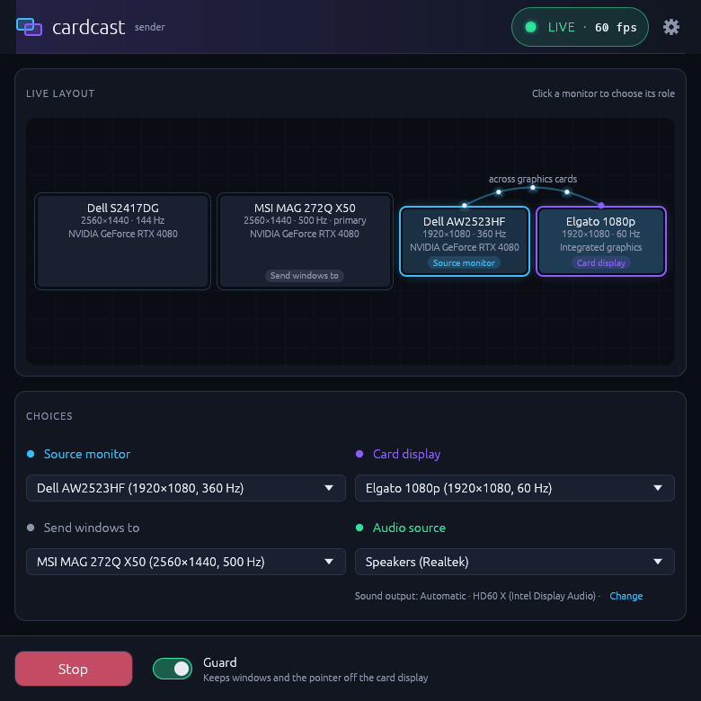
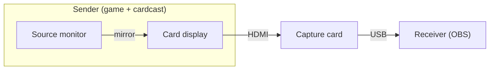
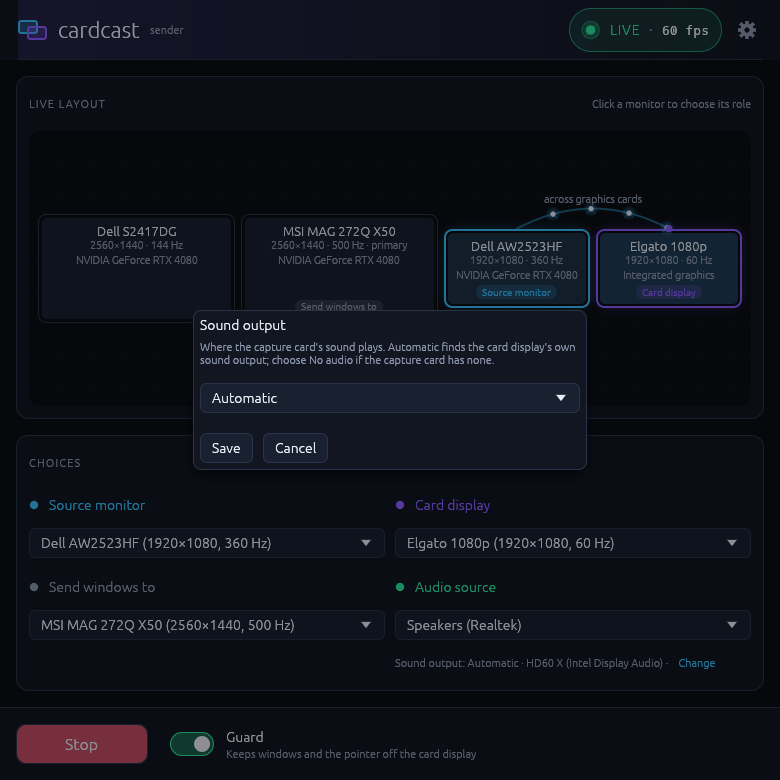
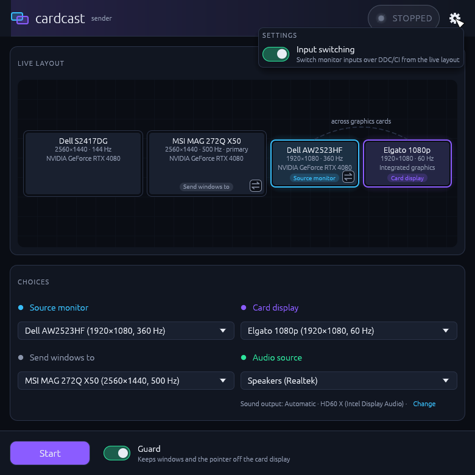
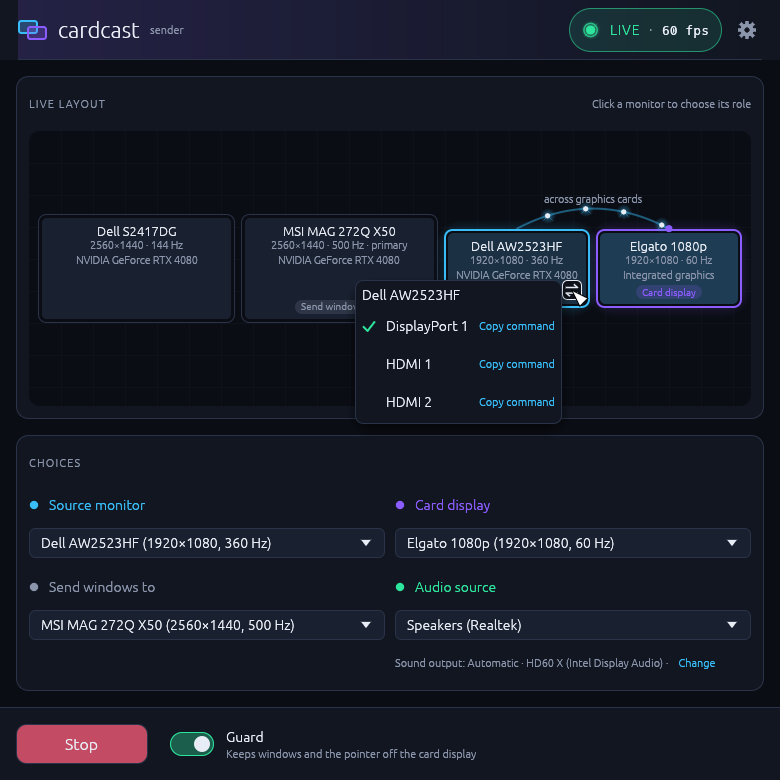

<h1 align="center">cardcast</h1>

<p align="center"><b>Two-PC streaming with a capture card: cardcast mirrors your game monitor onto the capture card's display, so the second PC can capture it, and keeps windows and the pointer off that display.</b></p>

<p align="center">
  <a href="https://github.com/ClearlyNotMich/cardcast/actions/workflows/ci.yml"></a>
  <a href="https://github.com/ClearlyNotMich/cardcast/releases/latest"></a>
  <a href="LICENSE"></a>
</p>

<p align="center">
  
</p>

cardcast is a small Windows program for streaming with two PCs and a capture card. It runs on the sender, the PC the game runs on. The receiver needs no cardcast software: OBS on the receiver adds the capture card as a video source.



## Get started in 3 steps

1. **Download** `cardcast-v0.1.0.exe` from the [latest release](https://github.com/ClearlyNotMich/cardcast/releases/latest). There is no installer. It is unsigned, so SmartScreen asks first: **More info → Run anyway**.
2. **Plug in** the capture card: its HDMI input into the sender's graphics card, its USB side into the receiver. In Windows Display settings, set the card display to **Extend these displays**, never Duplicate.
3. **Run** `cardcast.exe` (not as administrator). Click a monitor in the live layout to make it the source monitor or the card display, and press **Start**. On the receiver, add the capture card as a video source in OBS.

## What it does

- 🪞 **Mirror**: shows the source monitor on the card display at the card display's own refresh rate, HDR turned to SDR, with the pointer. The card display may sit on another graphics card or the integrated graphics.
- 🛡️ **Window guard and pointer guard**: windows and the pointer can't stay on the card display, and the game keeps focus.
- 🔊 **Sound**: plays the audio source into the capture card, so the capture card carries sound.
- 🔀 **Input switching**: switch a monitor's input from the live layout, or from a Stream Deck key.
- Recovers by itself when the capture card is unplugged, the resolution changes, a permission prompt appears or the graphics device is lost.

Terms are defined in [`GLOSSARY.md`](GLOSSARY.md). The full design is in [`SPEC.md`](SPEC.md) and [`docs/adr/`](docs/adr/).

<details>
<summary><b>Setup details</b></summary>

1. Plug the capture card's HDMI input into the sender's graphics card, and its USB side into the receiver. Any capture card that shows up in Windows as a monitor works; tested with the Elgato HD60 X and the AVerMedia Live Gamer Mini.
2. Plug the card display into the same graphics card as the source monitor if it has a free output, or else into another one (a second graphics card or the processor's integrated graphics). cardcast then copies the picture across, which costs the source monitor's graphics card a little work (ADR 0003).
   - On an NVIDIA graphics card, a monitor using Display Stream Compression (DSC, common on high-refresh monitors) can take two of the card's four display heads, so with two such monitors the card display may get no signal. A lower refresh rate or resolution on one of them, or turning DSC off on it (some monitors do this when switched from DisplayPort 1.4 to 1.2), frees a head, but costs that monitor refresh rate. Plugging the card display into the other graphics card keeps it.
3. In Windows Display settings, set the card display to **Extend these displays**, never Duplicate.
4. Set the card display's resolution and refresh rate in Windows (for example 1920×1080 at 60 Hz). cardcast never changes display modes. For 120 or 240 Hz, see **Higher refresh rates** below.
5. The card display must not be the primary monitor.
6. The source monitor can run with Windows HDR on or off. The mirror is always SDR.

**Games: use borderless mode.** Run games in borderless (windowed fullscreen) mode. A game in exclusive fullscreen may not be capturable and can show a black mirror. When a game enters or leaves exclusive fullscreen, or the resolution changes, cardcast re-creates the capture by itself.

**Sound.** cardcast records what the audio source plays and plays it again on the sound output. You keep hearing the audio source normally on the sender. Audio problems never stop the mirror. To choose which programs go to the capture card, use Windows' own per-app sound settings (Settings > System > Sound > Volume mixer): send those programs to the audio source. cardcast has no per-app settings.

Each push also builds `cardcast.exe` in GitHub Actions: open the **Actions** tab, pick the latest green run of the **CI** workflow, and download the `cardcast-exe` artifact.

</details>

<details>
<summary><b>Settings</b></summary>

<p align="center"></p>

The settings window has these controls. Each monitor dropdown shows the monitor's name, resolution and refresh rate.

- **Source monitor**: the monitor to mirror. Never the card display.
- **Card display**: the capture card's display. Never the source monitor, the "send windows to" monitor or the primary monitor.
- **Send windows to**: where the window guard returns windows that land on the card display. Defaults to the primary monitor. Never the card display.
- **Audio source**: the playback device whose sound goes to the capture card.
- **Sound output** (the line under Audio source, **Change** to pick): where that sound is played so the capture card carries it. **Automatic** (default) finds the card display's own sound output. Pick a playback device yourself if Automatic finds the wrong one or none, or **No audio** if your capture card has no sound; the mirror runs either way. When Automatic finds nothing, the status line says so and offers **Choose sound output**.
- **Start / Stop**: starts or stops the mirror. Audio starts and stops with it.
- **Guard**: turns the window guard and the pointer guard on and off together. On by default; it does nothing until the card display is chosen. The guard works whether or not the mirror is running.
- **Live layout**: your monitors as Windows arranges them, to scale, each marked with what it is chosen as. Click a monitor to make it the source monitor, the card display or the "send windows to" monitor. While the mirror runs, the header says LIVE with the frame rate the card display gets.
- **Status line**: shows "Running", "Waiting for card display", "Waiting for source monitor", "Stopped", or the last error in plain words, followed by any audio or guard problem. If the mirror keeps up with fewer than 90% of the card display's refreshes for a few seconds, it says so (see **Higher refresh rates**). While the button shows Stop, the mirror runs or starts again by itself; a mirror stopped by an error stays stopped until you press Start.

The dropdowns and the live layout offer a monitor only for the roles it can take, so a choice that can't work can't be made. To swap the source monitor and the card display, first make a third monitor the card display. If Windows makes the card display the primary monitor, the live layout says so in red and the mirror refuses to start until you choose another card display. Settings saved by an older cardcast with the source monitor or "send windows to" on the card display are fixed at launch: that choice is cleared ("send windows to" goes back to the primary monitor), and the status line says so.

Choices are saved when you change them. Changing the source monitor, card display or audio source while the mirror runs or waits restarts it on the new choice at once. A new sound output restarts only the audio. On launch the mirror starts by itself, and the window starts minimised if it does. Closing the window quits cardcast.

cardcast also remembers the connector the card display is plugged into, so it finds the card display again when the capture card changes its name (for example a different EDID mode). A different monitor plugged into that connector therefore becomes the card display, unless it is the source monitor, the "send windows to" monitor or the primary monitor; then cardcast keeps waiting for the card display.

If you unplug the capture card or the source monitor, the mirror stops and the status line says which one it's waiting for. Plug it back in and the mirror and audio pick up by themselves.

**Window guard and pointer guard.**

- Any window that lands on the card display is moved to the "send windows to" monitor, without taking focus from the game. A maximised window stays maximised there.
- If the same window keeps going back to the card display (more than 3 times within a minute), the guard stops moving it and names it in the status line, so it never fights a program. The notice stays until you press **Dismiss guard notice**, or until that window leaves the card display or closes; then the guard watches it again. Turning the guard off and on, or changing the card display or "send windows to", also resets this.
- If "send windows to" is the card display, or there is no monitor to send windows to, the guard does nothing and says so in the status line.
- The pointer is checked about 60 times a second. If it is on the card display, it is put back where it was last seen on another monitor.
- On Linux the window guard works on X11 and on KDE Plasma. On Plasma, cardcast loads a KWin script while the guard is on; it is unloaded when the guard stops, and unloads itself within a second if cardcast quits or crashes. If KWin restarts, the status line says so and the guard comes back by itself. On other desktops, and for the pointer guard, the status line says it does not work there yet.

</details>

<details>
<summary><b>Input switching and a Stream Deck key</b></summary>

<p align="center"> </p>

cardcast can switch a monitor's input over DDC/CI, like the monitor's own buttons do: show the receiver on the AW2523HF, say, then switch back.

In the settings window, click the cog at the top right and switch on **Input switching** (it is off by default, and then cardcast sends nothing over DDC/CI). cardcast then reads each monitor's inputs, which can take a few seconds. A monitor that lists two or more gets a small button at the bottom right of its tile in the live layout: it lists the inputs with the current one ticked, and clicking one switches the monitor. **Copy command** copies the command below for that monitor and input, ready for a shortcut. DDC/CI can't tell which inputs have a cable plugged in.

Run with arguments, `cardcast.exe` does one switch and exits. It opens no window and doesn't touch the settings, and works whether or not the settings window is open.

```
cardcast.exe input <monitor> <input>
cardcast.exe input <monitor> toggle <input> <input>
```

- `<monitor>` is the monitor's EDID serial (for example `4GZY5P3`) or its name as the settings window shows it (for example `"AW2523HF"`), ignoring case. If two monitors share the name, use the serial.
- `<input>` is `dp`, `dp2`, `hdmi1`, `hdmi2`, or a value `0x01` to `0xFF` for any other input (some makers use their own value for USB-C). The monitor must list it over DDC/CI.
- `toggle a b` switches to `b` when the monitor is on `a`, otherwise to `a`.

The exit code is 0 when the monitor took the switch or was already on that input, 1 when the switch failed (no such monitor, an input it doesn't list, or no answer over DDC/CI), and 2 when the command was not understood. One line saying what happened goes to standard error, which you only see when you capture it: in a `.cmd` script, `cardcast.exe input 4GZY5P3 hdmi1 2> result.txt` waits for cardcast, then `%ERRORLEVEL%` is the exit code and `result.txt` holds the line. Typed at a command prompt, cmd doesn't wait for cardcast, so `%ERRORLEVEL%` there is not its exit code.

A monitor that switched its input away can drop out of Windows, as if you'd unplugged it. cardcast can't switch it back then; use the monitor's own buttons. If it was the source monitor or the card display, the mirror waits for it and carries on when it returns.

**A Stream Deck key.**

1. Right-click the desktop and choose **New > Shortcut**. For the location, type the command with the full path to `cardcast.exe` in quotes, for example `"C:\Tools\cardcast\cardcast.exe" input 4GZY5P3 toggle dp hdmi1`. Name it, for example `Toggle AW2523HF`.
2. In the Stream Deck app, drag **System > Open** onto a key, and for **App / File** choose that shortcut (the `.lnk` file).

Press the key and the monitor switches, and the game keeps focus. Don't set a **Shortcut key** on the shortcut instead: Windows ignores shortcut keys while a fullscreen program runs, so they won't work in games.

</details>

<details>
<summary><b>Higher refresh rates (120 or 240 Hz)</b></summary>

60 Hz is the usual case. If your capture card can take 120 or 240 Hz, the mirror can run at that rate too. cardcast never changes display modes: you set the rate in Windows, and the mirror follows it, drawing once per refresh of the card display.

1. Check that your capture card supports the mode (resolution and refresh rate) on its HDMI input, and that the receiver captures it at that rate (in OBS, the capture card source's resolution and FPS). A mode the card doesn't support shows no picture or is refused by Windows.
2. In Windows, open **Settings > System > Display**, select the card display, and open **Advanced display**. Under **Choose a refresh rate**, pick 120 Hz or 240 Hz. Windows lists only the rates the capture card offers.
3. Start cardcast (or let it run on). The header shows the frame rate the card display gets, for example about 120 fps at 120 Hz.

A higher rate costs the sender more: the mirror draws more often, and when the card display is on another graphics card than the source monitor, the picture crossing between the cards grows with the rate (for 1080p, about 0.5 GB/s at 60 Hz and 1 GB/s at 120 Hz; ADR 0003). If the sender can't keep up, the status line says the mirror shows fewer frames than the card display's refresh rate; set a lower rate in step 2.

</details>

<details>
<summary><b>Known limits</b></summary>

- **Admin windows.** cardcast does not run as administrator, so the window guard cannot move windows of programs that run as administrator. If one opens on the card display, move it yourself with Win+Shift+Arrow.
- Changing the SDR content brightness slider in Windows while the mirror runs has no effect until the mirror is restarted.
- A rotated (portrait) source monitor shows un-rotated in the mirror.
- Pointer pixels that normally invert the screen are drawn black, so such a pointer can vanish on dark scenes.
- If the mirror can't start or is interrupted for a reason that can pass (a monitor or graphics card going away, a driver reset, a mode change, a permission prompt), it tries again every second and the status line says why. A failure that can't pass (Windows or the graphics driver too old, a fault in cardcast) stops it with the reason; press Start to try again.
- The primary monitor is taken to be the one at the top-left corner (0,0) of the Windows desktop. Not yet confirmed on the sender.
- Automatic finds the card display's sound output by the container ID Windows gives a monitor and its HDMI sound, else by name. Not yet confirmed on the sender; choose the sound output yourself if it picks wrong.

**Reporting a problem.** Open an issue on GitHub at `ClearlyNotMich/cardcast`. Include what you did and what happened instead, the text of the status line, the release or CI run the `.exe` came from, your monitors and capture card, and whether HDR was on.

</details>

<details>
<summary><b>Linux (in progress, not released)</b></summary>

Linux support is being worked on ([#36](https://github.com/ClearlyNotMich/cardcast/issues/36)). No release includes it yet. Parts not yet built for Linux say "does not work on Linux yet" in the status line. So far:

On Linux the sound goes through PipeWire, which needs PipeWire 0.3.44 or newer with its command-line tools (`pw-dump`, `pw-loopback`) and WirePlumber 0.4.12 or newer running:

- Arch and CachyOS: `pipewire-audio` and `wireplumber`
- Debian and Ubuntu: `pipewire-bin` and `wireplumber`
- Fedora: `pipewire-utils` and `wireplumber`

With an older PipeWire or WirePlumber, cardcast does not start the audio, because the sound could play back into the audio source; the status line says which one to update.

The input switch command is `cardcast input <monitor> …`, and it works the same way as on Windows. cardcast talks to the monitor through `/dev/i2c-*`, which needs the `i2c-dev` kernel module and access for your user, no root. The tarball has both files in `packaging/linux/` (the AUR package will install them for you):

```
sudo cp packaging/linux/modules-load.d/i2c-dev.conf /etc/modules-load.d/
sudo cp packaging/linux/udev/rules.d/60-cardcast-i2c.rules /etc/udev/rules.d/
sudo modprobe i2c-dev
sudo udevadm control --reload
sudo udevadm trigger
```

Or copy the two files and restart. Until then, the status line and the command say which step is missing. With NVIDIA's own driver, some monitors only answer after setting `NVreg_RegistryDwords=RMUseSwI2c=0x01` ([ddcutil](https://www.ddcutil.com/nvidia/)).

</details>

<details>
<summary><b>Building from source</b></summary>

cardcast is written in Rust. With a stable Rust toolchain:

```
cargo build --release
```

On Windows this builds `target\release\cardcast.exe`. On Linux it needs PipeWire's headers and libclang (Ubuntu: `libpipewire-0.3-dev libclang-dev`; Arch: `pipewire clang`). The tests are `cargo test`; on Linux they also render the settings window to `tests/snapshots/` with Mesa's software Vulkan (`mesa-vulkan-drivers`). The images in this README are rendered by the same tests; regenerate them with `UPDATE_README_MEDIA=1 cargo test readme_media` (they're written to `docs/media/`).

</details>

## Licence

cardcast is free software under the GNU General Public License, version 3 or (at your option) any later version. See [LICENSE](LICENSE).
